# Trabajo Práctico N° 6: Redes de Computadoras

**Integrantes:**
* Arias, Daniel Andrés
* Garzón, Pablo
* Gutierrez, Patricio
* Fernández y Fernández, Sergio Ezequiel
* Loza Denardi, Gabriel Jeremías
* Rocatagliatta, Leandro Agustin
* Zambellini, Matías Manuel

---
## PARTE 1: Taller de armado y verificación de cables Cat5/Cat5e bajo estándar T568A/B

### Inciso 1

Para crimpar un cable de red **derecho** (directo) bajo la norma *T568A/B*, lo primordial es mantener el mismo código de colores en ambos extremos del cable. La norma más usada a nivel comercial y residencial es la **T568B** (la utilizada para este trabajo práctico).

Para poder armar el cable es necesario contar con:
* Cable de red de par trenzado (Cat5, Cat5e, Cat6).
* Dos conectores **RJ45**.
* Herramienta crimpadora.
* Pelacables.

Una vez que se cuenta con los materiales se deben seguir los siguientes pasos:
* **Pelar el cable:** Utilizar el pelacables para quitar entre **2 o 3 cm** de la cubierta exterior de plástico del cable de ambos extremos. Se debe tener cuidado de no cortar los hilos de cobre internos.
* **Desenredar y estirar los hilos:** Al tener los extremos ya pelados, se podrán observar 4 pares de hilos trenzados. Se debe separarlos, desenredarlos y estirarlos lo más derecho posible para que sea fácil ordenarlos (idealmente utilizar los dedos para este paso).
* **Ordernar los hilos según la norma elegida:** Según la norma elegida, se deben acomodar los hilos en cada extremo siguiendo un orden. Es sumamente importante que, para el tipo de cable **derecho**, en ambos extremos se debe respetar el mismo orden de los hilos:
    * *T568B:* De izquierda a derecha se debe colocar `blanco-naranja`, `naranja`, `blanco-verde`, `azul`, `blanco-azul`, `verde`, `blanco-marrón`, `marrón`.
    * *T568A:* De izquierda a derecha se debe colocar `blanco-verde`, `verde`, `blanco-naranja`, `azul`, `blanco-azul`, `naranja`, `blanco-marrón`, `marrón`.
* **Cortar a la medida:** Una vez que los cables estén en su orden específico y de forma plana, cortarlos de forma limpia y recta, dejando aproximadamente de **1.2 a 1.5 cm** de hilos expuestos desde el borde de la cubierta exterior.
* **Introducir los hilos en los conectores RJ45:** Con la pestaña de plástico del conector hacia abajo, se deben introducir todos los hilos firmemente hasta el fondo. Asegurarse que los hilos llegaron hasta el tope del conector y que la cubierta exterior del cable quede dentro del conector.
* **Crimpar el conector:** Introducir el conector *RJ45* en la ranura correspondiente de la crimpadora. Presionar los mangos con fuerza de forma constante. Al escuchar el clic es cuando los pines dorados pinchan los hilos y la pestaña de seguridad fija la cubierta del cable.
* **Repetir en el otro extremo:** Repetir los mismos pasos en el extremo que falta. Asegurarse de utilizar la misma orden que se usó en el primer extremo.

Si se cuenta con un tester, es posible verificar si el cable fue armado correctamente.

---

### Inciso 2

Siguiendo todos los pasos mencionados en el inciso anterior, logramos armar nuestro cable de red derecho bajo la norma **T568B** durante el horario de cursada. Al contar con testers probadores, pudimos afirmar que armamos el cable de forma correcta.

* **Prueba de funcionamiento de nuestro cable armado:**

.gif)

---

### Incisos 3 y 4

Para este punto, intercambiamos nuestro cable de red con el del grupo **"Los Red(ondos)"** una única vez, adelantando que estaba armado de forma correcta.

* a) * **Cable armado por el grupo "Los Red(ondos) (1)":**
).jpeg)

**Cable armado por el grupo "Los Red(ondos) (2)":**
)%20(2).jpeg)

Como puede observarse en la fotografía, todas las conexiones están hechas de forma correcta, los cables no son difíciles de identificar, el cable de red cuenta con un tamaño adecuado para usar fácilmente, los hilos dentro del conector también cuentan con un tamaño adecuado para lograr un buen crimpeado, llegar el tope y lograr buenas conexiones, y tal como se mencionó anteriormente, el cable funcionaba de manera correcta. Concluyendo así en una buena fabricación por parte del grupo con el que intercambiamos cables.

* b) **Verificación eléctrica del cable armado por el grupo "Los Red(ondos)":**

).gif)

Tal como se mencionó, el cable del otro grupo estaba armado de forma correcta y funcionaba como tenía qué. En las siguientes partes de este trabajo, se utiliza este mismo cable para lograr un correcto envío y una correcta recepción de datos hacia y desde otro grupo mediante la utilización de un switch intermedio.

---

## PARTE 2: Equipamiento físico, verificación y utilización de equipos de red y generación de tráfico

### Inciso 1. Configuración manual de la interfaz de red

La Parte 2 del trabajo práctico se realizó en conjunto con el grupo **Bitless**. Para las pruebas se conectaron equipos de ambos grupos a una misma LAN, con el fin de intercambiar mensajes y analizar el tráfico generado.

Durante la experiencia se configuró manualmente la interfaz Ethernet de una de las computadoras con los siguientes parámetros:

| Parámetro | Valor |
|---|---|
| Dirección IPv4 | `192.168.1.100` |
| Máscara de subred | `255.255.255.0` (`/24`) |
| Red correspondiente | `192.168.1.0/24` |
| Puerta de enlace predeterminada | Sin configurar |
| DNS | Sin configurar |

La elección de una dirección IPv4 privada dentro de la red `192.168.1.0/24` permitió realizar pruebas de comunicación local. En las capturas de Wireshark también se identifica el equipo `192.168.1.72`, que pertenece a la misma subred si utiliza máscara `/24`. No era necesaria una puerta de enlace predeterminada para comunicar equipos pertenecientes a la misma red local, ya que el tráfico podía circular a través del switch sin utilizar un router. Tampoco se requería un servidor DNS para acceder mediante direcciones IP.

**Evidencia: configuración IPv4 de uno de los equipos.**

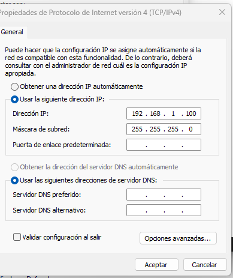

### Inciso 2. Montaje de la LAN y prueba de conectividad

Para la práctica se utilizó un **switch TP-Link TL-SF1008D**, en lugar del Cisco Catalyst 2950 propuesto en la guía. El TP-Link es un equipo no administrable, por lo que no requiere configuración mediante consola ni habilitación manual de puertos. Se conectaron las computadoras a través de cables Ethernet y se realizó el montaje que se observa en las siguientes fotografías.

**Evidencia: disposición de equipos durante el laboratorio.**

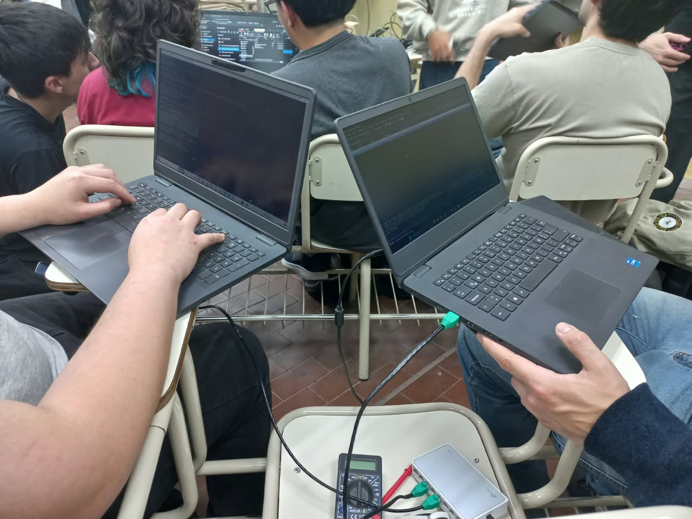

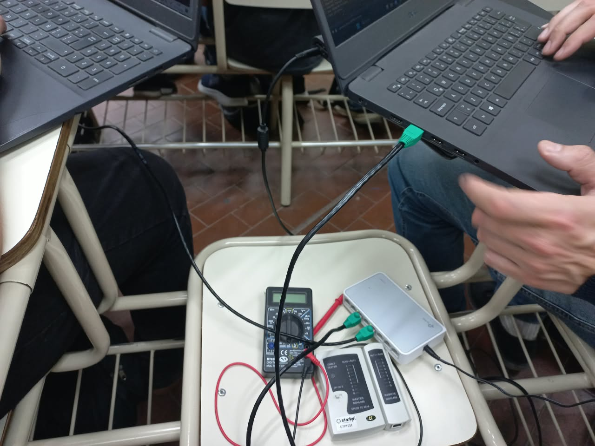

Se ejecutó `ping` entre las computadoras para comprobar la conectividad IP. Inicialmente se presentaron dificultades, pero luego se consiguió obtener respuestas exitosas. **No se conservó una captura de pantalla del resultado del ping**, por lo que este resultado se consigna como observación realizada durante la práctica. El tráfico UDP capturado más adelante también aporta evidencia de comunicación entre los equipos.

### Inciso 3. Generación de tráfico UDP

Como parte del intercambio entre **Los Tíos** y **Bitless**, se utilizó **Packet Sender**, alternativa admitida por la consigna, para preparar mensajes UDP hacia la IP `192.168.1.72` y el puerto de destino `5555` (en lugar del puerto 5000 usado en el ejemplo de la guía).

En la captura de Packet Sender se observa el mensaje ASCII `sq sq los-tios network`, de 22 bytes, utilizado para identificar a nuestro grupo (**Los Tíos**), junto con el protocolo UDP, la IP de destino y el puerto seleccionado. El grupo **Bitless** también envió un mensaje identificándose por su nombre, observable en las capturas de Wireshark.

**Evidencia: preparación del mensaje en Packet Sender.**

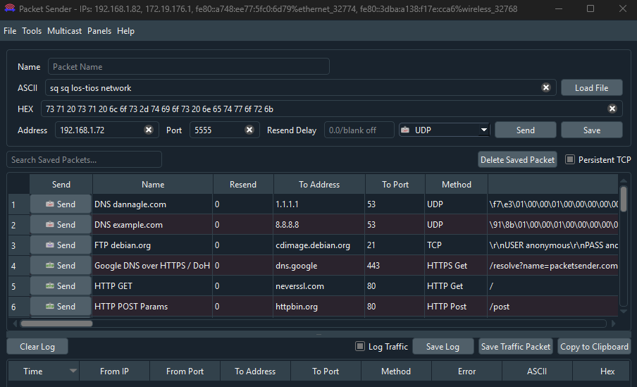

La captura de la aplicación muestra los parámetros de envío; la evidencia de los datagramas efectivamente capturados se presenta en el inciso siguiente.

### Inciso 4. Captura y análisis mediante Wireshark

Se realizó una captura sobre la interfaz Ethernet y se utilizó el filtro de visualización `udp.port == 5555` para localizar los intercambios UDP relacionados con el puerto elegido.

En las imágenes se observan los siguientes datagramas:

| IP origen | IP destino | Puerto origen | Puerto destino | Datos UDP |
|---|---|---:|---:|---:|
| `192.168.1.100` | `192.168.1.72` | 51206 | 5555 | 10 bytes |
| `192.168.1.100` | `192.168.1.72` | 51206 | 5555 | 22 bytes |
| `192.168.1.72` | `192.168.1.100` | 55995 | 5555 | 20 bytes |

**Evidencia: datagrama de 10 bytes.**

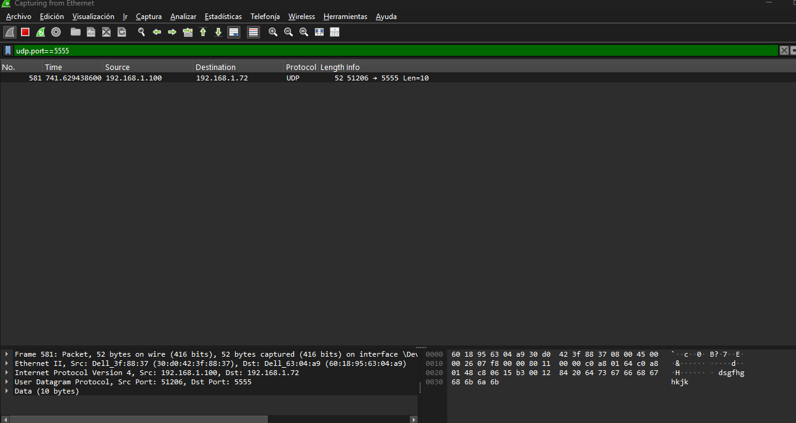

**Evidencia: datagrama de 22 bytes, consistente con el texto preparado en Packet Sender.**

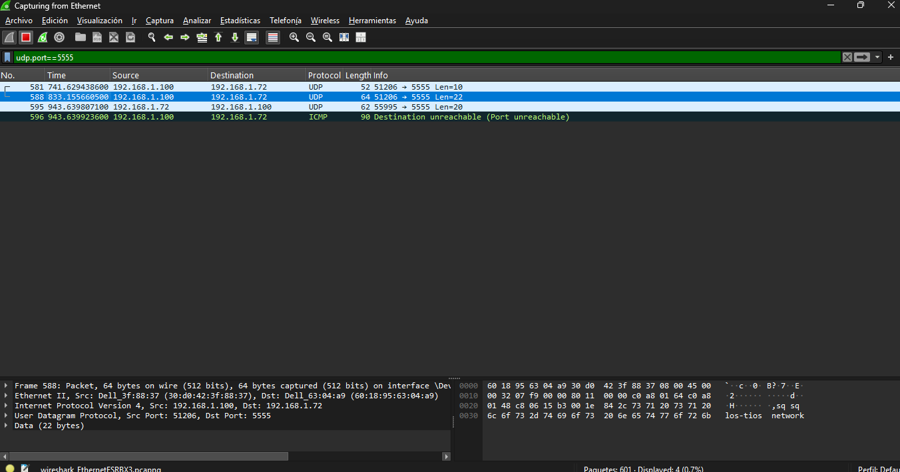

**Evidencia: datagramas en ambos sentidos —incluido el mensaje enviado por Bitless— y mensaje ICMP.**

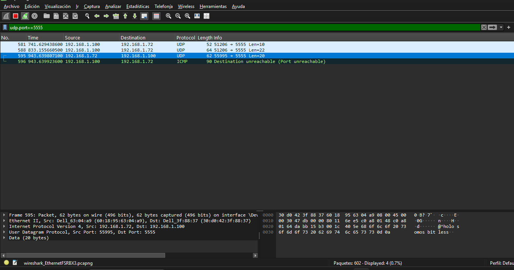

En la captura `06_wireshark_udp_respuesta_icmp.png` se distinguen claramente las columnas **Source** (origen) y **Destination** (destino):

- **Paquetes UDP 581 y 588:** origen `192.168.1.100` (**Los Tíos**) y destino `192.168.1.72` (**Bitless**).
- **Paquete UDP 595:** origen `192.168.1.72` (**Bitless**) y destino `192.168.1.100` (**Los Tíos**). Su contenido identifica al grupo Bitless.
- **Paquete ICMP 596:** origen `192.168.1.100` (**Los Tíos**) y destino `192.168.1.72` (**Bitless**). Wireshark lo identifica como **Destination Unreachable (Port Unreachable)**.

El mensaje ICMP se envió **en sentido contrario al datagrama UDP 595**: fue generado por el equipo `192.168.1.100` e indica que el puerto UDP al que se dirigió ese datagrama no estaba disponible. No significa que los demás mensajes UDP no hayan circulado por la red.

Las capturas de Wireshark permiten identificar los mensajes enviados por ambos grupos y verificar que se generó tráfico UDP en las dos direcciones, cumpliendo con el objetivo de observación de la práctica.

### Inciso 5. Preguntas sobre UDP

**a) ¿Se observa algún procedimiento de establecimiento de conexión antes de enviar los datos?**

No. UDP es un protocolo de transporte no orientado a conexión. No realiza un establecimiento previo equivalente al *three-way handshake* de TCP. En las capturas se observan datagramas UDP sin paquetes de negociación de conexión propios de UDP.

**b) ¿Existe algún mecanismo de confirmación de recepción equivalente a los ACK de TCP?**

No. UDP no incorpora confirmaciones de recepción ni retransmisiones automáticas equivalentes a las de TCP. Si una aplicación necesita verificar la recepción o recuperar datagramas perdidos, debe implementar mecanismos adicionales. Las capturas muestran intercambios de datagramas, no confirmaciones de recepción definidas por UDP.

**c) ¿Qué ocurre si se envían mensajes mientras el receptor UDP no está ejecutándose?**

Cuando se envía un datagrama UDP a un puerto que no está disponible, el equipo de destino puede responder con un mensaje ICMP *Destination Unreachable – Port Unreachable*. En nuestra captura, el paquete UDP 595 viajó desde `192.168.1.72` (**Bitless**) hacia `192.168.1.100` (**Los Tíos**); a continuación, el equipo `192.168.1.100` generó el mensaje ICMP 596 dirigido a `192.168.1.72`. Esto muestra que UDP no comprueba previamente si el puerto de destino está disponible.

**d) ¿UDP garantiza que los mensajes lleguen en el mismo orden en que fueron enviados?**

No. UDP no garantiza la entrega, el orden ni la ausencia de duplicados. Cada datagrama puede experimentar un recorrido o demora distintos. Una aplicación que requiera orden debe incorporar sus propios identificadores de secuencia y mecanismos de reorganización. Esta es una propiedad del protocolo; la captura realizada no constituye una prueba de desorden en la entrega.

**e) ¿Qué aplicaciones reales utilizan UDP y por qué?**

UDP se utiliza, por ejemplo, en consultas DNS tradicionales, DHCP, comunicaciones multimedia en tiempo real y determinados videojuegos en línea. Resulta útil por su encabezado reducido y por evitar el establecimiento de conexión y la retransmisión obligatoria a nivel de transporte. Cada aplicación decide si necesita incorporar mecanismos adicionales de confiabilidad o control de tiempos.

### Actividad final. Desarrollo de un pequeño servidor HTTP

Esta actividad se realizó con **dos computadoras propias del grupo**, sin intervención de otro grupo. Un equipo con **Ubuntu 26.04 LTS** actuó como servidor HTTP y como punto de captura con Wireshark. Un equipo con **Windows 11** actuó como cliente, mediante el navegador Google Chrome y la herramienta `curl`.

#### Configuración de red

Ambos equipos se conectaron por **WiFi a la misma red doméstica**, en lugar de utilizar el cable y el switch de las actividades anteriores. La consigna de esta actividad solo requiere que la segunda computadora pueda alcanzar al servidor mediante su dirección IP, y HTTP, TCP e IP funcionan de la misma forma sobre WiFi que sobre Ethernet. Como la red WiFi ya ubicaba a ambos equipos en la misma subred, no fue necesario configurar direcciones manualmente. En la Linux la dirección se obtiene por DHCP (método `auto` de NetworkManager).

| Equipo | Rol | Interfaz | Dirección IPv4 | Dirección MAC |
|---|---|---|---|---|
| Ubuntu 26.04 LTS | Servidor HTTP y captura | `wlp2s0` (WiFi) | `192.168.1.7/24` | `a8:6d:aa:91:8c:0f` (Intel) |
| Windows 11 | Cliente | Wi-Fi | `192.168.1.6/24` | `5c:a6:e6:d9:95:f7` (TP-Link) |

Ambas direcciones pertenecen a la red `192.168.1.0/24`, por lo que la comunicación es directa dentro de la LAN. La puerta de enlace `192.168.1.1` que figura en la Windows solo se utiliza para alcanzar otras redes y no interviene en este intercambio. La conectividad entre ambos equipos queda demostrada por el propio intercambio TCP analizado en el inciso 4: el establecimiento de una conexión requiere que los segmentos lleguen en ambos sentidos.

**Evidencia: dirección IPv4 del servidor (Linux).**

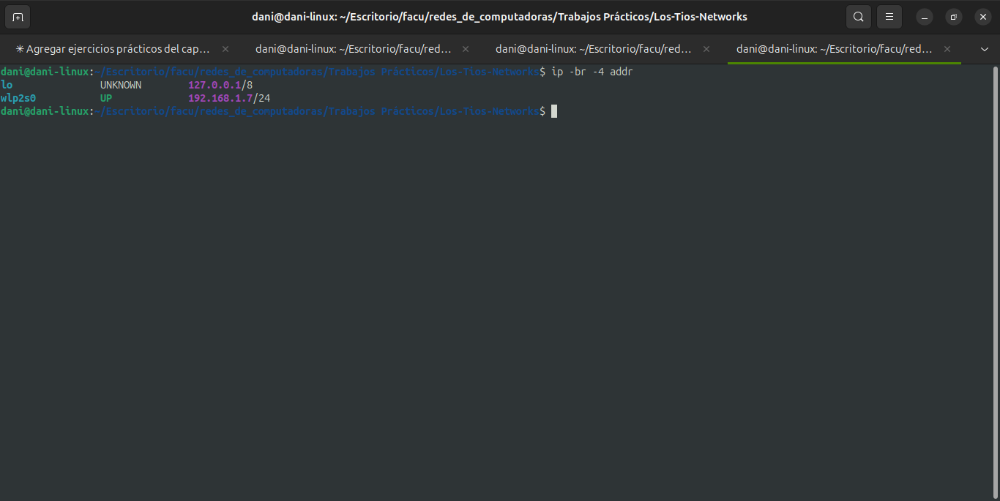

**Evidencia: dirección IPv4 del cliente (Windows).**

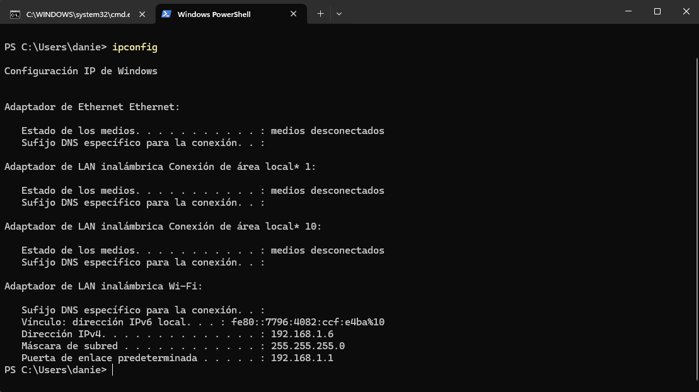

#### Inciso 1. Directorio y servidor HTTP

En la Linux se creó el directorio `~/servidor_tp6` con tres archivos de tipos diferentes:

| Archivo | Tipo | Tamaño |
|---|---|---:|
| `archivo.pdf` | Documento PDF (enunciado de este TP) | 369.766 bytes |
| `archivo.txt` | Texto plano | 45 bytes |
| `imagen.png` | Imagen PNG | 25.443 bytes |

Se utilizó un directorio dedicado porque `http.server` publica todo el contenido de la carpeta desde la que se ejecuta, incluidas sus subcarpetas, para cualquier equipo de la red. Tampoco se incluyó un archivo `index.html`: si existiera, el servidor mostraría esa página en lugar del listado de archivos.

**Evidencia: contenido del directorio publicado.**

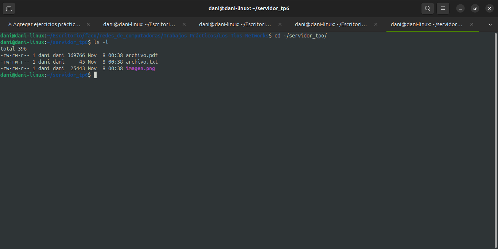

El servidor se inició desde ese directorio con Python 3.14.4:

```bash
cd ~/servidor_tp6
python3 -m http.server 8000
```

El servidor respondió `Serving HTTP on 0.0.0.0 port 8000`. La dirección `0.0.0.0` indica que escucha en todas las interfaces IPv4 del equipo, incluida la interfaz WiFi. Se mantuvo el puerto 8000 propuesto en la consigna, que además es el predeterminado del módulo: al ser mayor a 1024 no requiere permisos de administrador y no entra en conflicto con el puerto 80.

#### Inciso 2. Acceso desde el navegador

Desde la Windows se ingresó con Google Chrome a `http://192.168.1.7:8000/`. El servidor respondió con la página **"Directory listing for /"**, que lista los tres archivos. Chrome marca el sitio como **"No es seguro"** porque HTTP no cifra la comunicación. Luego se descargó `archivo.pdf`, que el navegador informa con un tamaño de 361 KB (369.766 bytes / 1024).

**Evidencia: listado del directorio en el navegador del cliente.**

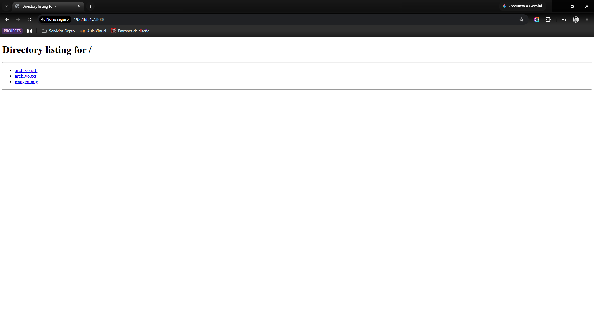

**Evidencia: descarga completada en el navegador.**

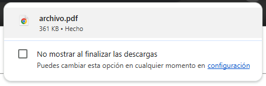

El servidor registra cada pedido en la terminal con la IP del cliente, la fecha y hora, la línea del pedido y el código de respuesta. Se observan los dos pedidos de Chrome desde `192.168.1.6`: `GET /` y `GET /archivo.pdf`, ambos con código **200**.

**Evidencia: inicio del servidor y registro de los pedidos.**

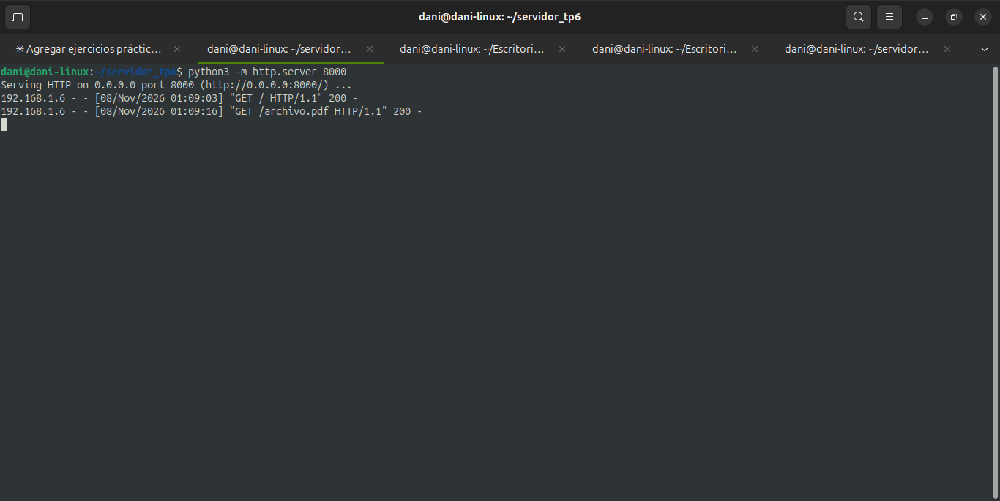

#### Inciso 3. Descarga con curl

Desde el Símbolo del sistema de la Windows, en la carpeta `C:\tp6`, se repitió la descarga con:

```bash
curl -v -O http://192.168.1.7:8000/archivo.pdf
```

La opción `-O` guarda el archivo con el mismo nombre que tiene en el servidor y `-v` muestra los detalles de la conexión y los encabezados intercambiados. En la salida se observa:

- `Established connection to 192.168.1.7 (192.168.1.7 port 8000) from 192.168.1.6 port 64756`: la conexión TCP sale de un **puerto efímero** asignado por Windows (64756) hacia el puerto 8000 del servidor.
- **Pedido** (líneas `>`): `GET /archivo.pdf HTTP/1.1`, con los encabezados `Host`, `User-Agent: curl/8.21.0` y `Accept: */*`.
- **Respuesta** (líneas `<`): `HTTP/1.0 200 OK`, con `Server: SimpleHTTP/0.6 Python/3.14.4`, `Content-type: application/pdf` y `Content-Length: 369766`.
- `HTTP 1.0, assume close after body` y, al final, `shutting down connection #0`: como el servidor responde con HTTP/1.0, la conexión se cierra después de cada respuesta. Esto se comprueba en la captura del inciso 4.

Para verificar la integridad se calculó el hash SHA-256 del archivo descargado en la Windows (`certutil`) y del original en la Linux (`sha256sum`). Ambos dan el mismo valor, `d6e1f8965f59de1ee36154525e860bc7fc3cb30797ba04d7ffa423a1636bebd8`, por lo que la copia es idéntica byte a byte al original: TCP entregó los 369.766 bytes completos y en orden.

**Evidencia: descarga con curl y hash del archivo recibido (Windows).**

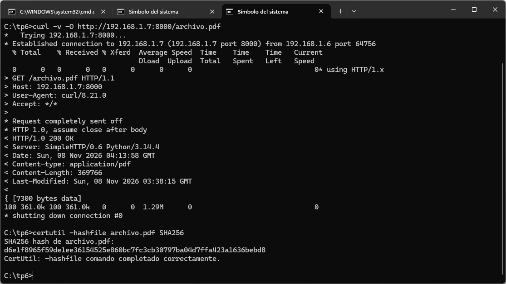

**Evidencia: hash del archivo original (Linux).**

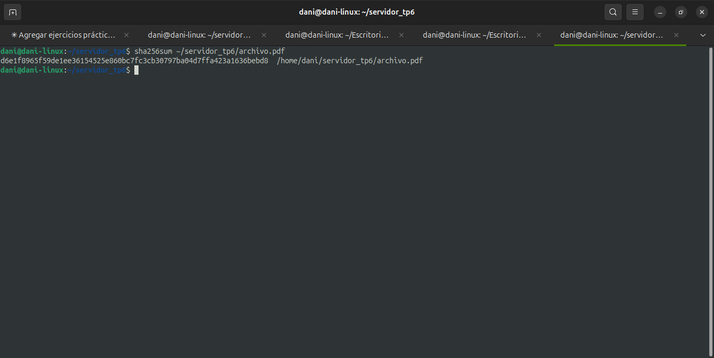

#### Inciso 4. Captura con Wireshark: ¿de qué tipo es el tráfico?

La captura se realizó en la Linux, sobre la interfaz `wlp2s0`, con el filtro de visualización `tcp.port == 8000`. Se capturó en el servidor porque, al ser un extremo de la conexión, recibe y envía todos los paquetes del intercambio. Se identificaron tres conexiones TCP. El tamaño de cada pedido surge de los números de secuencia del cliente:

| Puerto del cliente | Aplicación | Pedido | Respuesta | Tamaño del pedido |
|---:|---|---|---|---:|
| 64751 | Chrome | `GET /` | `HTTP/1.0 200 OK` (`text/html`) | 472 bytes |
| 59878 | Chrome | `GET /archivo.pdf` | `HTTP/1.0 200 OK` (`application/pdf`) | 333 bytes |
| 64756 | curl | `GET /archivo.pdf` | `HTTP/1.0 200 OK` (`application/pdf`) | 91 bytes |

Los pedidos de Chrome son más grandes porque incluyen más encabezados, como `Connection: keep-alive`, `Upgrade-Insecure-Requests` y el `User-Agent` completo del navegador. Estos encabezados se ven en el panel hexadecimal de la evidencia del pedido y la respuesta.

**Establecimiento de la conexión.** Con el filtro `tcp.flags.syn == 1` se observa que cada conexión comienza con el *three-way handshake* de TCP. El tercer paso, el `ACK` del cliente, aparece en el gráfico de flujo más adelante. Las opciones negociadas son:

- **MSS=1460** en ambos sentidos: 1500 bytes de MTU menos 20 bytes de encabezado IP y 20 bytes de encabezado TCP.
- **WS=256** (escalado de ventana) en el `SYN` de la Windows. Permite anunciar ventanas mayores a 65.535 bytes: en el cierre de la conexión de Chrome, el cliente anuncia `Win=524032`, un valor que no podría expresarse sin escalado.
- **SACK_PERM**: ambos extremos admiten confirmaciones selectivas.

Chrome abrió **dos conexiones en el mismo instante** (paquetes 141 y 142, puertos 59878 y 64751). Usó la 64751 para pedir el listado y dejó la 59878 abierta, que reutilizó 12,7 segundos después para descargar el PDF (paquete 236). curl, en cambio, abrió **una sola conexión** (paquete 2372, puerto 64756), el mismo puerto que informó en su salida.

**Evidencia: establecimiento de las conexiones (SYN y SYN-ACK).**

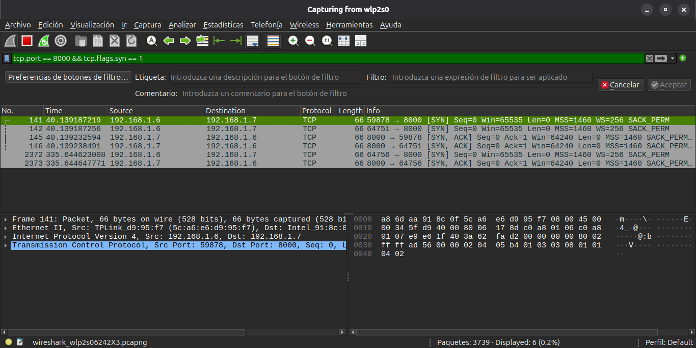

**Pedido y respuesta HTTP.** Con el filtro `http`, Wireshark identificó el tráfico del puerto 8000 como HTTP de forma automática. Los clientes piden con **HTTP/1.1**, pero el servidor de Python responde con **HTTP/1.0**, su versión predeterminada. El `Content-type` de cada respuesta corresponde al recurso pedido: `text/html` para el listado y `application/pdf` para el archivo.

**Evidencia: pedidos GET y respuestas 200 OK.**

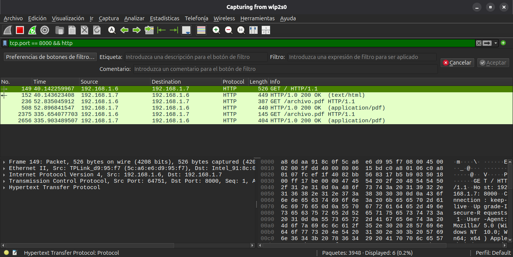

**Transferencia de los datos.** El gráfico de flujo de la conexión de curl muestra la secuencia completa:

1. `SYN`, `SYN, ACK` y `ACK`: establecimiento de la conexión.
2. `GET /archivo.pdf` de 91 bytes, que el servidor confirma con `Ack=92`.
3. El servidor envía los encabezados de la respuesta en un segmento `PSH, ACK` de 195 bytes (`Seq` de 1 a 196). Después envía el PDF en segmentos de **1460 bytes**, el MSS negociado (`Seq=196, 1656, 3116, 4576…`).
4. El cliente responde con **ACK acumulativos**: por ejemplo, `Ack=7496` confirma de una sola vez el segmento de encabezados y los cinco primeros segmentos del archivo.

Los números de secuencia son consistentes con lo transferido: 1 + 195 bytes de encabezados + 369.766 bytes del PDF + 1 por el `FIN` del servidor = **369.963**. Ese es exactamente el `Ack` que envía el cliente en su `FIN` (paquete 2660).

**Evidencia: gráfico de flujo de la conexión de curl.**

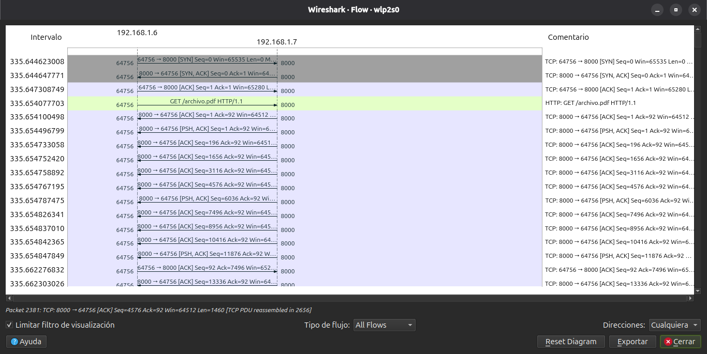

**Contenido sin cifrar.** La opción *Seguir secuencia TCP* reconstruye la conversación de curl completa en texto plano: el pedido, los encabezados de la respuesta y el comienzo del PDF (`%PDF-1.4`, `/Title (RC - TP N6)`). La conversación tiene un paquete de datos del cliente y 256 del servidor, unos 370 kB en total. Cualquiera que pueda capturar este tráfico puede leerlo o reconstruir el archivo, ya que HTTP no cifra. Para evitarlo se necesitaría HTTPS, es decir, HTTP sobre TLS.

**Evidencia: conversación reconstruida con "Seguir secuencia TCP".**

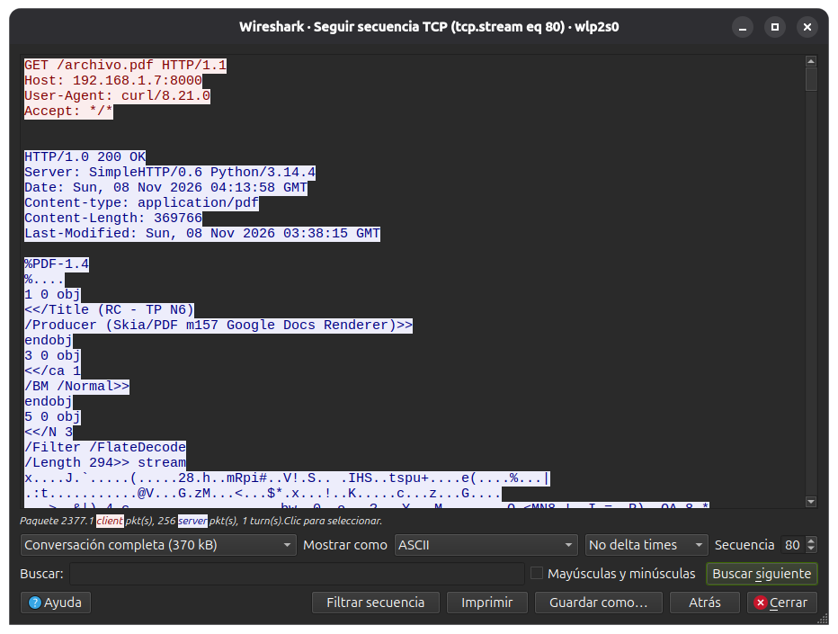

**Cierre de la conexión.** Con el filtro `tcp.flags.fin == 1` se observa que, en las tres conexiones, **el servidor cierra primero**. Su `FIN` viaja en el mismo segmento que la última parte de la respuesta HTTP: por eso los paquetes 152, 508 y 2656 aparecen con este filtro. Luego el cliente responde con su propio `FIN, ACK` (paquetes 155, 512 y 2660). Este comportamiento se debe a que el servidor responde con HTTP/1.0 y cierra la conexión después de cada respuesta, como anticipó curl con `assume close after body`. Por eso cada descarga utiliza su propia conexión TCP. El paquete 140 pertenece a una conexión anterior del cliente cuyo inicio no quedó en la captura: Wireshark la marca como incompleta y, al no haber visto el *handshake*, no puede aplicar el escalado de ventana (`Win=255`).

**Evidencia: segmentos con FIN.**

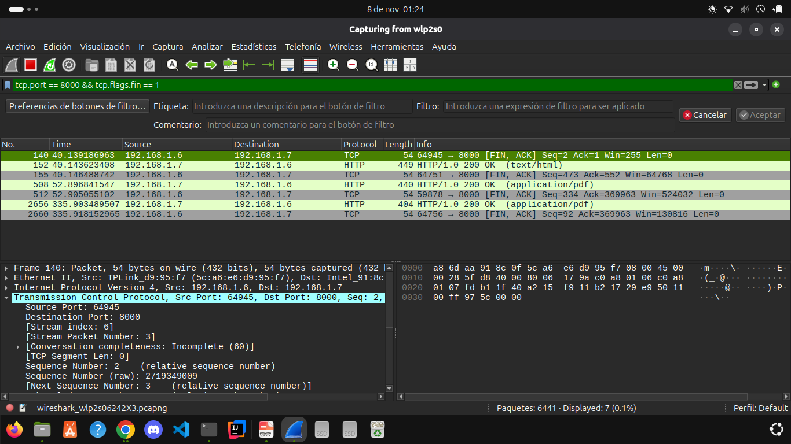

**Jerarquía de protocolos.** Para la conexión de curl (`tcp.stream eq 80`), las estadísticas muestran 290 tramas, todas Ethernet → IPv4 → TCP. HTTP aparece solo en 2 paquetes, el pedido y la respuesta reensamblada, pero esos paquetes concentran el **95,9 % de los bytes**. La entrada *Media Type* corresponde al cuerpo del PDF: 369.766 bytes. Los encabezados Ethernet (14 bytes × 290 = 4.060 bytes), IPv4 (20 bytes × 290 = 5.800 bytes) y TCP (5.824 bytes) representan alrededor del 4 % de los 385.736 bytes de la conexión.

La captura se hizo sobre WiFi, pero Wireshark muestra tramas **Ethernet II**. En modo normal (*managed*), la placa WiFi entrega las tramas al sistema operativo ya convertidas a formato Ethernet, con las direcciones MAC de ambos adaptadores (TP-Link en la Windows, Intel en la Linux). Para ver los encabezados 802.11 haría falta capturar en modo monitor.

**Evidencia: jerarquía de protocolos de la conexión de curl.**

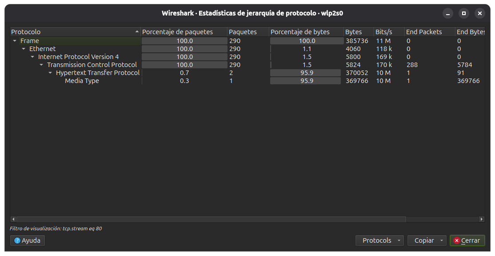

**Respuesta: ¿de qué tipo es el tráfico?**

Es tráfico **HTTP**, de capa de aplicación y con un modelo de pedido y respuesta (`GET` → `200 OK`). Se transporta sobre **TCP**, un protocolo orientado a conexión y confiable, que a su vez va sobre **IPv4** y tramas **Ethernet II** (WiFi). Es tráfico **unicast** entre el cliente `192.168.1.6` (puertos efímeros 64751, 59878 y 64756) y el servidor `192.168.1.7:8000`, y viaja **sin cifrar**.

La comparación con el tráfico UDP analizado en los incisos anteriores resume las diferencias entre ambos protocolos de transporte:

| Aspecto | UDP (Packet Sender, puerto 5555) | HTTP sobre TCP (puerto 8000) |
|---|---|---|
| Establecimiento de conexión | No existe: los datagramas se envían directamente | *Three-way handshake* (`SYN`, `SYN-ACK`, `ACK`) |
| Confirmación de recepción | No existe | `ACK` acumulativos del receptor |
| Tamaño de los datos | Cada mensaje viaja en un único datagrama (10, 22 y 20 bytes) | El archivo de 369.766 bytes se divide en segmentos de hasta 1460 bytes y se reensambla en el destino |
| Cierre | No existe | `FIN` de ambos extremos |
| Integridad de los datos | No garantizada por el protocolo | Verificada: hash SHA-256 idéntico en origen y destino |

Como esta actividad no requirió modificar la configuración de red de ningún equipo, al finalizar no fue necesario restaurar direcciones IP, a diferencia de la Parte 2.
