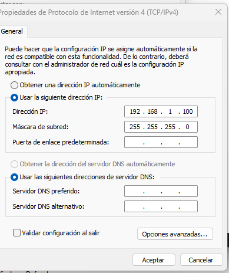
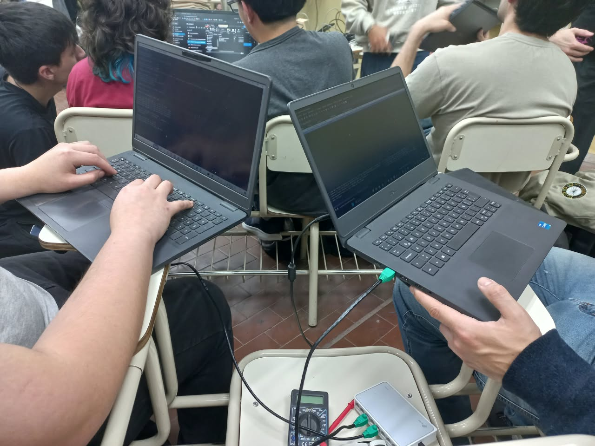
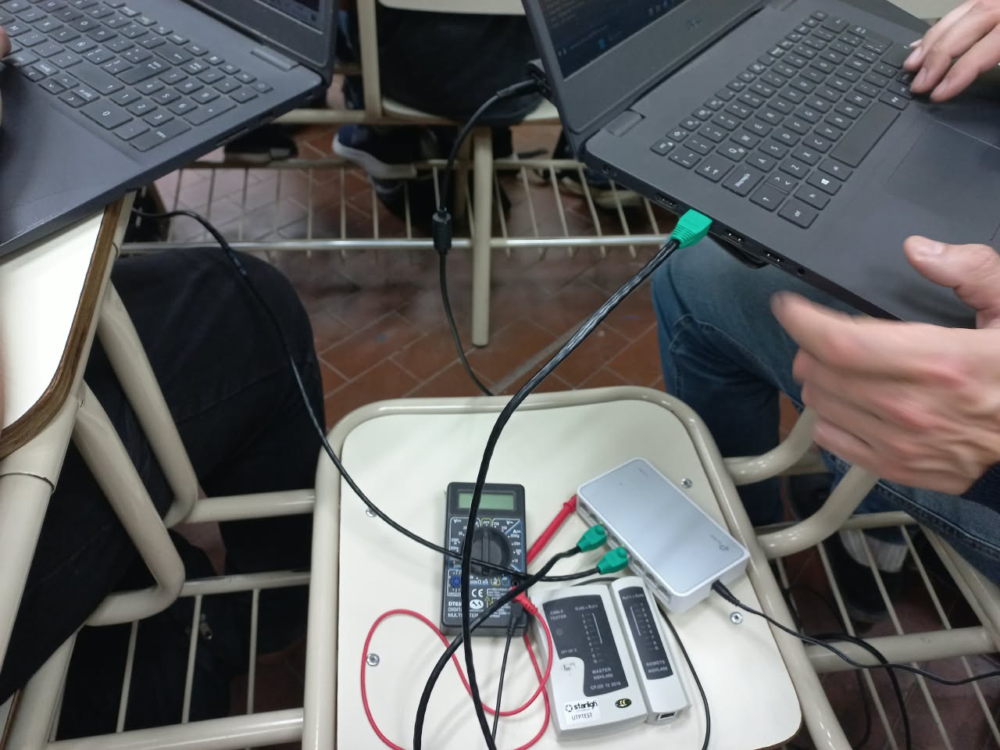
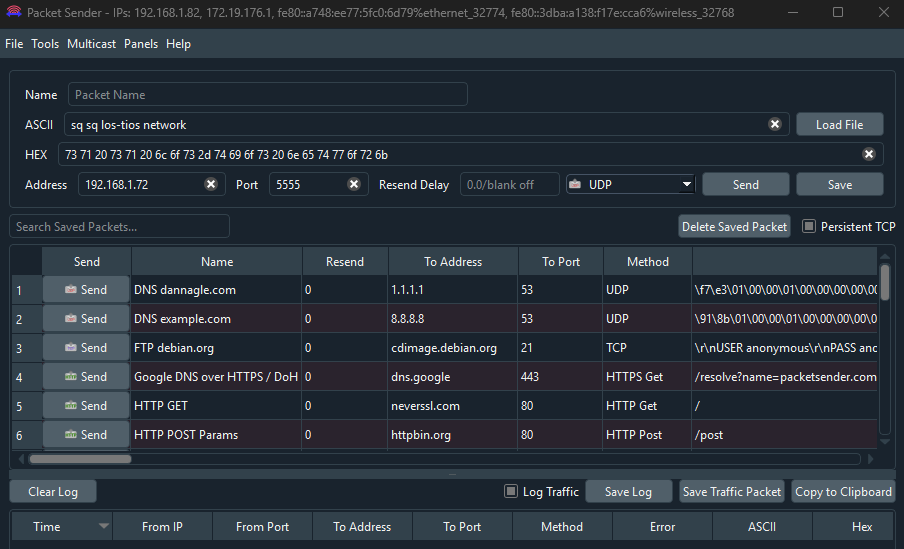
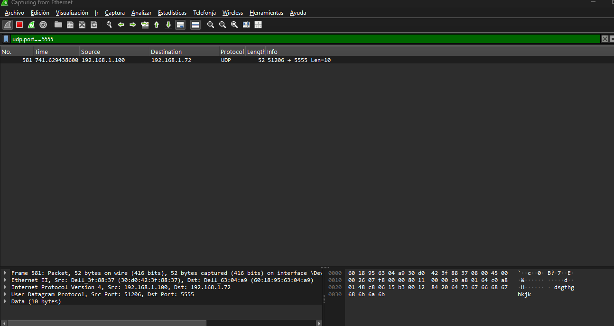
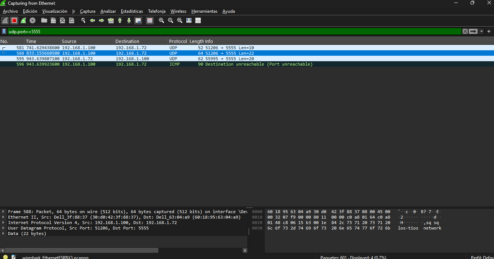
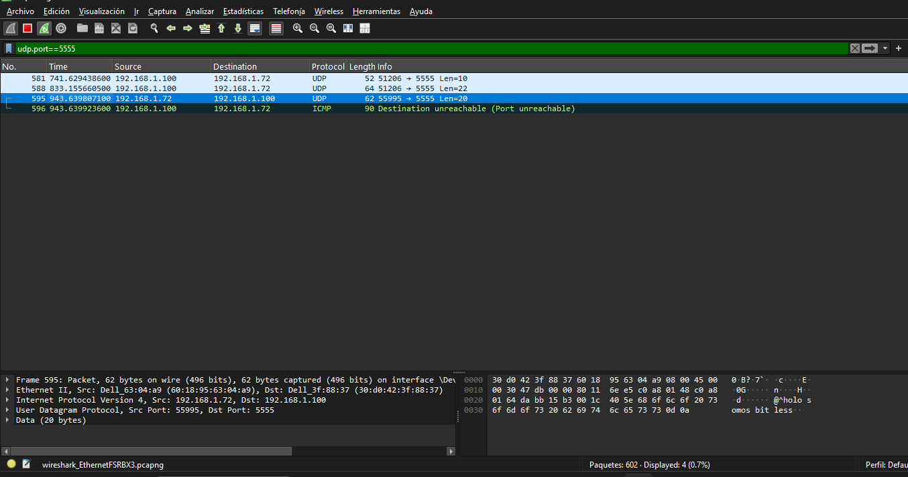

# Trabajo Práctico N° 6: Redes de Computadoras

**Integrantes:**
* Arias, Daniel Andrés
* Garzón, Pablo
* Gutierrez, Patricio
* Fernández y Fernández, Sergio Ezequiel
* Loza Denardi, Gabriel Jeremías
* Rocatagliatta, Leandro Agustin
* Zambellini, Matías Manuel

---
## PARTE 1: Taller de armado y verificación de cables Cat5/Cat5e bajo estándar T568A/B

### Inciso 1

Para crimpar un cable de red **derecho** (directo) bajo la norma *T568A/B*, lo primordial es mantener el mismo código de colores en ambos extremos del cable. La norma más usada a nivel comercial y residencial es la **T568B** (la utilizada para este trabajo práctico).

Para poder armar el cable es necesario contar con:
* Cable de red de par trenzado (Cat5, Cat5e, Cat6).
* Dos conectores **RJ45**.
* Herramienta crimpadora.
* Pelacables.

Una vez que se cuenta con los materiales se deben seguir los siguientes pasos:
* **Pelar el cable:** Utilizar el pelacables para quitar entre **2 o 3 cm** de la cubierta exterior de plástico del cable de ambos extremos. Se debe tener cuidado de no cortar los hilos de cobre internos.
* **Desenredar y estirar los hilos:** Al tener los extremos ya pelados, se podrán observar 4 pares de hilos trenzados. Se debe separarlos, desenredarlos y estirarlos lo más derecho posible para que sea fácil ordenarlos (idealmente utilizar los dedos para este paso).
* **Ordernar los hilos según la norma elegida:** Según la norma elegida, se deben acomodar los hilos en cada extremo siguiendo un orden. Es sumamente importante que, para el tipo de cable **derecho**, en ambos extremos se debe respetar el mismo orden de los hilos:
    * *T568B:* De izquierda a derecha se debe colocar `blanco-naranja`, `naranja`, `blanco-verde`, `azul`, `blanco-azul`, `verde`, `blanco-marrón`, `marrón`.
    * *T568A:* De izquierda a derecha se debe colocar `blanco-verde`, `verde`, `blanco-naranja`, `azul`, `blanco-azul`, `naranja`, `blanco-marrón`, `marrón`.
* **Cortar a la medida:** Una vez que los cables estén en su orden específico y de forma plana, cortarlos de forma limpia y recta, dejando aproximadamente de **1.2 a 1.5 cm** de hilos expuestos desde el borde de la cubierta exterior.
* **Introducir los hilos en los conectores RJ45:** Con la pestaña de plástico del conector hacia abajo, se deben introducir todos los hilos firmemente hasta el fondo. Asegurarse que los hilos llegaron hasta el tope del conector y que la cubierta exterior del cable quede dentro del conector.
* **Crimpar el conector:** Introducir el conector *RJ45* en la ranura correspondiente de la crimpadora. Presionar los mangos con fuerza de forma constante. Al escuchar el clic es cuando los pines dorados pinchan los hilos y la pestaña de seguridad fija la cubierta del cable.
* **Repetir en el otro extremo:** Repetir los mismos pasos en el extremo que falta. Asegurarse de utilizar la misma orden que se usó en el primer extremo.

Si se cuenta con un tester, es posible verificar si el cable fue armado correctamente.

---

### Inciso 2

Siguiendo todos los pasos mencionados en el inciso anterior, logramos armar nuestro cable de red derecho bajo la norma **T568B** durante el horario de cursada. Al contar con testers probadores, pudimos afirmar que armamos el cable de forma correcta.

* **Prueba de funcionamiento de nuestro cable armado:**

.gif)

---

### Incisos 3 y 4

Para este punto, intercambiamos nuestro cable de red con el del grupo **"Los Red(ondos)"** una única vez, adelantando que estaba armado de forma correcta.

* a) * **Cable armado por el grupo "Los Red(ondos) (1)":**
).jpeg)

**Cable armado por el grupo "Los Red(ondos) (2)":**
)%20(2).jpeg)

Como puede observarse en la fotografía, todas las conexiones están hechas de forma correcta, los cables no son difíciles de identificar, el cable de red cuenta con un tamaño adecuado para usar fácilmente, los hilos dentro del conector también cuentan con un tamaño adecuado para lograr un buen crimpeado, llegar el tope y lograr buenas conexiones, y tal como se mencionó anteriormente, el cable funcionaba de manera correcta. Concluyendo así en una buena fabricación por parte del grupo con el que intercambiamos cables.

* b) **Verificación eléctrica del cable armado por el grupo "Los Red(ondos)":**

).gif)

Tal como se mencionó, el cable del otro grupo estaba armado de forma correcta y funcionaba como tenía qué. En las siguientes partes de este trabajo, se utiliza este mismo cable para lograr un correcto envío y una correcta recepción de datos hacia y desde otro grupo mediante la utilización de un switch intermedio.

---

## PARTE 2: Equipamiento físico, verificación y utilización de equipos de red y generación de tráfico

### Inciso 1. Configuración manual de la interfaz de red

La Parte 2 del trabajo práctico se realizó en conjunto con el grupo **Bitless**. Para las pruebas se conectaron equipos de ambos grupos a una misma LAN, con el fin de intercambiar mensajes y analizar el tráfico generado.

Durante la experiencia se configuró manualmente la interfaz Ethernet de una de las computadoras con los siguientes parámetros:

| Parámetro | Valor |
|---|---|
| Dirección IPv4 | `192.168.1.100` |
| Máscara de subred | `255.255.255.0` (`/24`) |
| Red correspondiente | `192.168.1.0/24` |
| Puerta de enlace predeterminada | Sin configurar |
| DNS | Sin configurar |

La elección de una dirección IPv4 privada dentro de la red `192.168.1.0/24` permitió realizar pruebas de comunicación local. En las capturas de Wireshark también se identifica el equipo `192.168.1.72`, que pertenece a la misma subred si utiliza máscara `/24`. No era necesaria una puerta de enlace predeterminada para comunicar equipos pertenecientes a la misma red local, ya que el tráfico podía circular a través del switch sin utilizar un router. Tampoco se requería un servidor DNS para acceder mediante direcciones IP.

**Evidencia: configuración IPv4 de uno de los equipos.**

### Inciso 2. Montaje de la LAN y prueba de conectividad

Para la práctica se utilizó un **switch TP-Link TL-SF1008D**, en lugar del Cisco Catalyst 2950 propuesto en la guía. El TP-Link es un equipo no administrable, por lo que no requiere configuración mediante consola ni habilitación manual de puertos. Se conectaron las computadoras a través de cables Ethernet y se realizó el montaje que se observa en las siguientes fotografías.

**Evidencia: disposición de equipos durante el laboratorio.**

Se ejecutó `ping` entre las computadoras para comprobar la conectividad IP. Inicialmente se presentaron dificultades, pero luego se consiguió obtener respuestas exitosas. **No se conservó una captura de pantalla del resultado del ping**, por lo que este resultado se consigna como observación realizada durante la práctica. El tráfico UDP capturado más adelante también aporta evidencia de comunicación entre los equipos.

### Inciso 3. Generación de tráfico UDP

Como parte del intercambio entre **Los Tíos** y **Bitless**, se utilizó **Packet Sender**, alternativa admitida por la consigna, para preparar mensajes UDP hacia la IP `192.168.1.72` y el puerto de destino `5555` (en lugar del puerto 5000 usado en el ejemplo de la guía).

En la captura de Packet Sender se observa el mensaje ASCII `sq sq los-tios network`, de 22 bytes, utilizado para identificar a nuestro grupo (**Los Tíos**), junto con el protocolo UDP, la IP de destino y el puerto seleccionado. El grupo **Bitless** también envió un mensaje identificándose por su nombre, observable en las capturas de Wireshark.

**Evidencia: preparación del mensaje en Packet Sender.**

La captura de la aplicación muestra los parámetros de envío; la evidencia de los datagramas efectivamente capturados se presenta en el inciso siguiente.

### Inciso 4. Captura y análisis mediante Wireshark

Se realizó una captura sobre la interfaz Ethernet y se utilizó el filtro de visualización `udp.port == 5555` para localizar los intercambios UDP relacionados con el puerto elegido.

En las imágenes se observan los siguientes datagramas:

| IP origen | IP destino | Puerto origen | Puerto destino | Datos UDP |
|---|---|---:|---:|---:|
| `192.168.1.100` | `192.168.1.72` | 51206 | 5555 | 10 bytes |
| `192.168.1.100` | `192.168.1.72` | 51206 | 5555 | 22 bytes |
| `192.168.1.72` | `192.168.1.100` | 55995 | 5555 | 20 bytes |

**Evidencia: datagrama de 10 bytes.**

**Evidencia: datagrama de 22 bytes, consistente con el texto preparado en Packet Sender.**

**Evidencia: datagramas en ambos sentidos —incluido el mensaje enviado por Bitless— y mensaje ICMP.**

En la captura `06_wireshark_udp_respuesta_icmp.png` se distinguen claramente las columnas **Source** (origen) y **Destination** (destino):

- **Paquetes UDP 581 y 588:** origen `192.168.1.100` (**Los Tíos**) y destino `192.168.1.72` (**Bitless**).
- **Paquete UDP 595:** origen `192.168.1.72` (**Bitless**) y destino `192.168.1.100` (**Los Tíos**). Su contenido identifica al grupo Bitless.
- **Paquete ICMP 596:** origen `192.168.1.100` (**Los Tíos**) y destino `192.168.1.72` (**Bitless**). Wireshark lo identifica como **Destination Unreachable (Port Unreachable)**.

El mensaje ICMP se envió **en sentido contrario al datagrama UDP 595**: fue generado por el equipo `192.168.1.100` e indica que el puerto UDP al que se dirigió ese datagrama no estaba disponible. No significa que los demás mensajes UDP no hayan circulado por la red.

Las capturas de Wireshark permiten identificar los mensajes enviados por ambos grupos y verificar que se generó tráfico UDP en las dos direcciones, cumpliendo con el objetivo de observación de la práctica.

### Inciso 5. Preguntas sobre UDP

**a) ¿Se observa algún procedimiento de establecimiento de conexión antes de enviar los datos?**

No. UDP es un protocolo de transporte no orientado a conexión. No realiza un establecimiento previo equivalente al *three-way handshake* de TCP. En las capturas se observan datagramas UDP sin paquetes de negociación de conexión propios de UDP.

**b) ¿Existe algún mecanismo de confirmación de recepción equivalente a los ACK de TCP?**

No. UDP no incorpora confirmaciones de recepción ni retransmisiones automáticas equivalentes a las de TCP. Si una aplicación necesita verificar la recepción o recuperar datagramas perdidos, debe implementar mecanismos adicionales. Las capturas muestran intercambios de datagramas, no confirmaciones de recepción definidas por UDP.

**c) ¿Qué ocurre si se envían mensajes mientras el receptor UDP no está ejecutándose?**

Cuando se envía un datagrama UDP a un puerto que no está disponible, el equipo de destino puede responder con un mensaje ICMP *Destination Unreachable – Port Unreachable*. En nuestra captura, el paquete UDP 595 viajó desde `192.168.1.72` (**Bitless**) hacia `192.168.1.100` (**Los Tíos**); a continuación, el equipo `192.168.1.100` generó el mensaje ICMP 596 dirigido a `192.168.1.72`. Esto muestra que UDP no comprueba previamente si el puerto de destino está disponible.

**d) ¿UDP garantiza que los mensajes lleguen en el mismo orden en que fueron enviados?**

No. UDP no garantiza la entrega, el orden ni la ausencia de duplicados. Cada datagrama puede experimentar un recorrido o demora distintos. Una aplicación que requiera orden debe incorporar sus propios identificadores de secuencia y mecanismos de reorganización. Esta es una propiedad del protocolo; la captura realizada no constituye una prueba de desorden en la entrega.

**e) ¿Qué aplicaciones reales utilizan UDP y por qué?**

UDP se utiliza, por ejemplo, en consultas DNS tradicionales, DHCP, comunicaciones multimedia en tiempo real y determinados videojuegos en línea. Resulta útil por su encabezado reducido y por evitar el establecimiento de conexión y la retransmisión obligatoria a nivel de transporte. Cada aplicación decide si necesita incorporar mecanismos adicionales de confiabilidad o control de tiempos.

### Actividad final. Servidor HTTP con Python — PENDIENTE

**Esta actividad todavía no se realizó y se completará en un próximo encuentro de laboratorio.** Queda pendiente documentar:

1. Creación de una carpeta con al menos tres archivos de tipos diferentes.
2. Ejecución de `python -m http.server 8000` en una computadora.
3. Acceso desde la segunda computadora mediante `http://<IP-del-servidor>:8000/` y descarga de un archivo.
4. Descarga de un archivo mediante `curl -O http://<IP-del-servidor>:8000/archivo.pdf`.
5. Captura con Wireshark del tráfico de la transferencia, identificación de HTTP y del protocolo de transporte TCP.

Al finalizar, se debe restaurar la configuración automática de direcciones IP de los equipos cuando corresponda.

