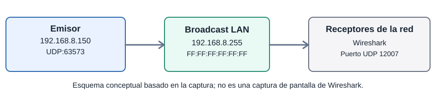
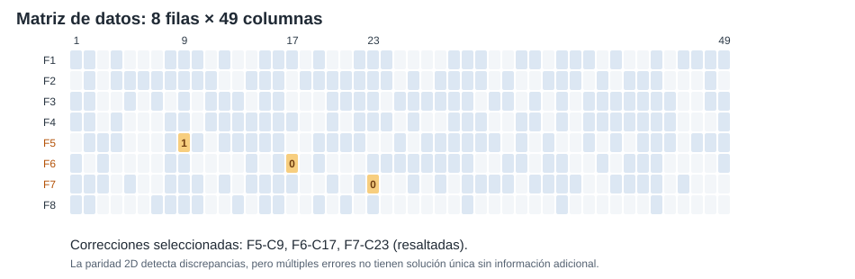

# Trabajo Práctico N° 7: Redes de Computadoras

**Integrantes:**
* Arias, Daniel Andrés
* Garzón, Pablo
* Gutierrez, Patricio
* Fernández y Fernández, Sergio Ezequiel
* Loza Denardi, Gabriel Jeremías
* Rocatagliatta, Leandro Agustin
* Zambellini, Matías Manuel

**Grupo:** Los-Tios-Networks  
**Fecha del laboratorio:** 29/10/2026

---

## PARTE 1: Desafío final — Captura y recuperación del mensaje

### Inciso 1. Direcciones de difusión de la red

Durante la actividad nos conectamos a la red Wi-Fi indicada por la cátedra para recibir los paquetes enviados desde el equipo del aula. Utilizamos la configuración de red predeterminada de Windows, sin asignar manualmente una dirección IPv4, máscara de subred ni puerta de enlace. La comunicación se realizó mediante broadcast, de modo que los equipos de la misma red pudieran recibir el mensaje.

En Wireshark identificamos estos datos:

| Campo | Valor |
|---|---|
| IP origen | `192.168.8.150` |
| IP destino | `192.168.8.255` |
| MAC origen | `DC:90:09:ED:91:35` |
| MAC destino | `FF:FF:FF:FF:FF:FF` |
| Protocolo | UDP |
| Puerto origen / destino | `63573` / `12007` |

La dirección `FF:FF:FF:FF:FF:FF` es una dirección MAC de difusión (broadcast), utilizada para enviar el mensaje a todos los equipos del segmento de red. El destino IPv4 utilizado fue `192.168.8.255`, que coincide con la dirección de difusión dirigida de la red `192.168.8.0/24`.

**Esquema de la transmisión:**



### Inciso 2. Captura en Wireshark

Abrimos Wireshark sobre la interfaz Wi-Fi y guardamos el tráfico en el archivo `captura 1.pcapng`. La captura duró aproximadamente 10 minutos y 12 segundos, por lo que supera los dos minutos pedidos en la consigna.

| Dato de la captura | Resultado |
|---|---|
| Tramas registradas | 7.033 |
| Duración | 611,7 segundos |
| Mensajes JSON del desafío | 22 tramas |
| Trama usada para analizar la matriz | 228 |

Para encontrar los paquetes nos resultaron útiles estos filtros de visualización:

```wireshark
frame contains "SIZE"
```

```wireshark
udp.srcport == 63573 && udp.dstport == 12007
```

El primero busca el texto `SIZE` dentro de los paquetes. El segundo permite ver el tráfico UDP correspondiente a los puertos que identificamos. Como son **filtros de visualización**, no descartan paquetes del archivo ya capturado.

Para acompañar el análisis, incluimos una [captura filtrada](Multimedia/TP7_mensajes_broadcast.pcapng) que contiene solamente las 22 tramas asociadas con el desafío. El archivo original se utilizó para los datos generales de la captura.

### Inciso 3. Formato del mensaje recibido

Al revisar la carga útil de los paquetes encontramos mensajes de texto con formato **JSON**. El que usamos para el análisis tenía los siguientes campos:

* **`SIZE`:** dimensiones de la matriz. En nuestro caso, `"8,7"`.
* **`PL`:** datos del mensaje, representados mediante caracteres `0` y `1`.
* **`CHECK`:** bits de paridad enviados para comprobar los datos. Primero aparecen los controles de las filas y después los de las columnas.

En esta actividad, `SIZE = "8,7"` representa **8 filas con 7 caracteres de 7 bits en cada fila**. Por lo tanto, cada fila tiene 49 bits de datos.

| Parte del mensaje | Cantidad |
|---|---:|
| Filas | 8 |
| Bits por fila | 7 × 7 = 49 |
| Bits de datos (`PL`) | 8 × 49 = **392** |
| Paridades de filas | 8 |
| Paridades de columnas | 49 |
| Total de bits de control (`CHECK`) | **57** |

También encontramos otros JSON, pero no todos tenían el contenido binario que necesitábamos. En la captura había cuatro variantes:

| `SIZE` / contenido | Cantidad de tramas | Observación |
|---|---:|---|
| `8,7` con datos binarios | 6 | Se pudo reconstruir la matriz. |
| `99,9` con texto de URL | 4 | Las longitudes no corresponden al esquema de paridad. |
| `N,M` con texto de URL | 6 | Las dimensiones no son numéricas. |
| `2,23` con texto de URL | 6 | El contenido no coincide con las dimensiones indicadas. |

Para continuar elegimos la variante `8,7`, porque permitía separar los datos y verificar las paridades como indica la consigna. Guardamos ese JSON en [este archivo](Multimedia/TP7_payload_original_limpio.json).

### Inciso 4. Cálculo y comparación de paridades

Primero separamos `PL` en 8 filas de 49 bits y guardamos la matriz en un archivo `.txt`, con una fila por línea. Después calculamos las paridades pares usando `paridad.py` y comparamos el resultado con `CHECK`.

| Paridad | Recibida | Calculada |
|---|---|---|
| Filas | `01111101` | `01110011` |
| Columnas | `0110111111110110011100101111001100001100110010001` | `0110111101110110111100001111001100001100110010001` |

Las diferencias aparecen en las **filas 5, 6 y 7** y en las **columnas 9, 17 y 23**, numeradas desde 1.

Con un único error, bastaría con cruzar la fila y la columna que fallan. Acá hay varias diferencias, así que las paridades por sí solas **no indican una única combinación posible de bits erróneos**.

Archivos utilizados:

* [Matriz original](Multimedia/TP7_matriz_original.txt).
* [Paridades recibidas](Multimedia/TP7_paridades_recibidas.txt).
* [Comparación completa](Multimedia/TP7_verificacion_paridades.txt).

### Inciso 5. Corrección de los datos

Probamos una corrección que resolviera las diferencias de paridad y permitiera leer el mensaje. Los tres bits que cambiamos fueron:

| Fila | Columna | Recibido | Corregido |
|---:|---:|:---:|:---:|
| 5 | 9 | `1` | `0` |
| 6 | 17 | `0` | `1` |
| 7 | 23 | `0` | `1` |



Luego de cambiar esos bits volvimos a calcular las paridades: **coincidieron las 8 de filas y las 49 de columnas** con los valores originales de `CHECK`.

La corrección cumple con los controles recibidos. Como hay tres errores, el síndrome por filas y columnas admite distintas combinaciones; usamos también la interpretación ASCII para seleccionar los tres cambios indicados.

**Matriz corregida:** [archivo de texto](Multimedia/TP7_matriz_corregida.txt).

### Inciso 6. Decodificación del mensaje

Con la matriz corregida, dejamos únicamente los bits de datos en un archivo de texto (sin agregar las paridades). Luego usamos los scripts de Python de la cátedra:

```powershell
py paridad.py TP7_matriz_corregida.txt
py decodificar_mensaje.py TP7_matriz_corregida.txt
```

El segundo programa interpreta grupos de 7 bits como caracteres ASCII. Al unir las líneas, el texto que obtuvimos fue:

```text
https://youtube.com/shorts/q8WgKzJwPa4?feature=share
```

El resultado es una dirección web de YouTube. Comprobamos la recuperación del texto y la coincidencia de las paridades, que eran los objetivos de esta etapa.

### Inciso 7 (opcional). Comparación automatizada

Para comparar los controles, calculamos las paridades con `paridad.py` y cotejamos los bits con `CHECK`. Los resultados de esa verificación quedaron registrados en el [archivo de comparación](Multimedia/TP7_verificacion_paridades.txt).

---

## PARTE 2: Reflexiones e investigación

### Inciso 1. ¿Qué pasa si hay dos errores o si falla un bit de control?

**a) Dos bits de datos alterados.** Si están en filas y columnas distintas, van a fallar dos paridades de fila y dos de columna. Esto deja cuatro intersecciones candidatas: no se puede saber con seguridad cuáles son los dos bits dañados. Si los dos errores están en una misma fila, la paridad de esa fila puede seguir dando bien, aunque fallen dos columnas.

También puede ocurrir que ciertos errores múltiples no se detecten; por ejemplo, invertir las cuatro esquinas de un rectángulo no cambia la paridad final de sus filas ni de sus columnas.

**b) Un bit de control alterado.** Si cambia un bit de paridad de una fila y los datos están intactos, solo va a fallar esa comprobación de fila. Lo mismo sucede con una columna. Esto sirve para sospechar que se dañó un control, pero no es un diagnóstico infalible si también admitimos varios errores de datos.

### Inciso 2. ¿Alcanza con adivinar el texto por contexto?

En un mensaje en castellano puede ser sencillo darse cuenta de que una palabra está mal escrita. Pero eso no sirve siempre: en una contraseña, una cuenta bancaria o una URL, cambiar un carácter puede dar otro dato válido y totalmente diferente.

Por eso, los bits de control son útiles: permiten revisar la información **sin depender de que el texto tenga sentido**. En nuestro caso, la URL recuperada nos ayudó a elegir una corrección posible, y después comprobamos que las paridades coincidieran.

### Inciso 3. ¿Cómo comprobamos la corrección?

Una vez modificados los tres bits, repetimos el cálculo de paridades. Coincidieron los **57 bits de control** con los que venían en `CHECK`. Además, el decodificador produjo una URL legible.

Consideramos que la corrección es **válida respecto de los controles recibidos**, pero no que sea necesariamente la única, porque se trataba de un caso con varios errores.

### Inciso 4. Código Hamming (7,4)

El código **Hamming (7,4)** toma 4 bits de datos y agrega 3 bits de paridad. El resultado es una palabra de 7 bits. Con paridad par, los bits de control se colocan en las posiciones 1, 2 y 4:

| Posición | 1 | 2 | 3 | 4 | 5 | 6 | 7 |
|---|---|---|---|---|---|---|---|
| Contenido | `p1` | `p2` | `d1` | `p4` | `d2` | `d3` | `d4` |

Los controles se calculan sobre estos grupos:

* `p1`: posiciones **1, 3, 5 y 7**.
* `p2`: posiciones **2, 3, 6 y 7**.
* `p4`: posiciones **4, 5, 6 y 7**.

Cada grupo tiene que tener una cantidad **par** de unos. En recepción se vuelve a comprobar la paridad y se obtiene un síndrome, escrito como `s4 s2 s1`. Si hay **un solo bit cambiado**, ese número binario indica la posición del error.

**Ejemplo con los datos `1101`:**

1. Colocamos los datos en las posiciones 3, 5, 6 y 7.
2. Calculamos `p1`, `p2` y `p4` para que todos los grupos tengan paridad par.
3. Obtenemos `1010101`.
4. Si cambia el bit 5, recibimos `1010001`. Al comprobar las paridades aparece el síndrome `101₂ = 5`.
5. Invertimos el bit 5 y recuperamos `1010101`, de donde extraemos nuevamente `1101`.

**¿En qué mejora a la paridad de filas y columnas?** Hamming (7,4) permite identificar y corregir un error **dentro de cada palabra de 7 bits**, sin tener que cruzar filas y columnas de una matriz completa. Su distancia mínima es 3: corrige un error y permite detectar hasta dos errores por palabra, aunque no puede corregir esos dos errores con seguridad. Si aparecen varios errores en una misma palabra, el síndrome puede llevar a una corrección equivocada.

**Aplicación a la carga útil del TP7.** Tomamos como datos los 392 bits de `PL` **ya corregidos**. Como Hamming (7,4) usa bloques de 4 bits:

```text
392 bits / 4 = 98 bloques de datos
98 bloques × 7 = 686 bits codificados
686 − 392 = 294 bits adicionales de control
Relleno necesario: 0 bits
```

Preparamos una propuesta de paquete con esos 98 bloques codificados y la dejamos en los archivos adjuntos:

* [Paquete JSON con Hamming (7,4)](Multimedia/TP7_paquete_hamming74.json).
* [Listado de los 98 bloques](Multimedia/TP7_hamming_74_bloques.txt).

En esta propuesta, Hamming agrega más bits de control (**294**) que la paridad 2D usada en el desafío (**57**). A cambio, cada bloque puede corregir un error por sí mismo. Los métodos tienen ventajas y límites distintos según el tipo y la cantidad de errores.

---

## Conclusión

En este TP capturamos tráfico UDP de broadcast con Wireshark y encontramos un mensaje JSON que incluía datos binarios y bits de paridad. Al comparar los controles detectamos diferencias en tres filas y tres columnas. Luego corregimos tres bits y recuperamos una dirección web.

La práctica nos sirvió para ver cómo la paridad ayuda a detectar errores y por qué, cuando hay varios bits dañados, no siempre alcanza para saber con certeza cuáles fueron. También aplicamos Hamming (7,4) a los datos recuperados para comparar ambos métodos.

